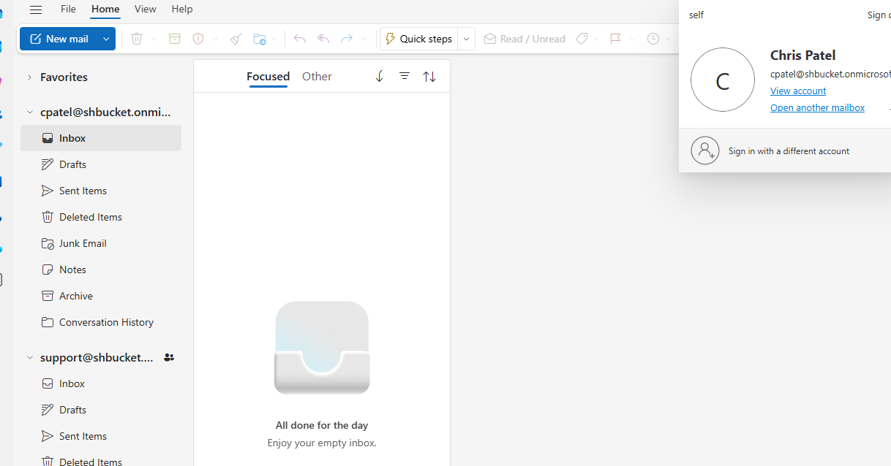
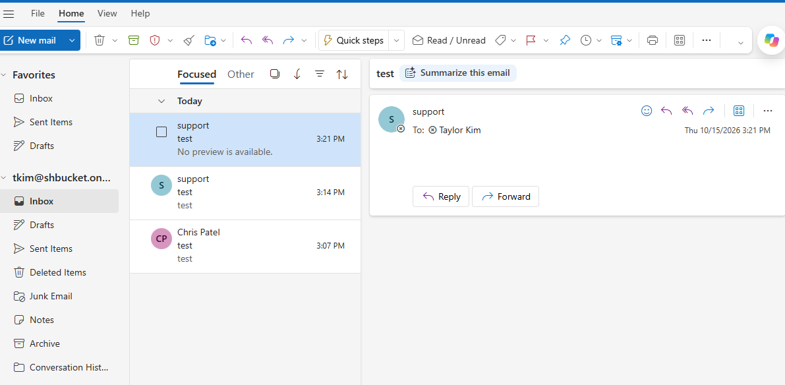
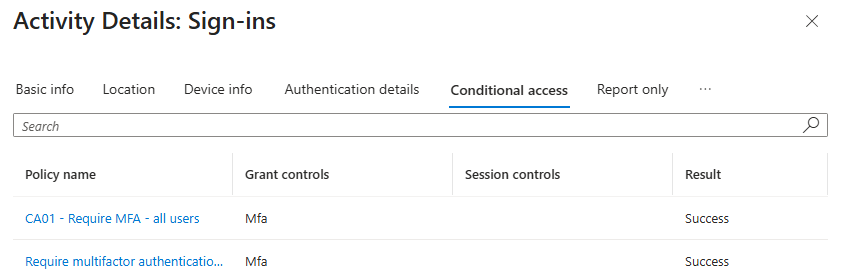
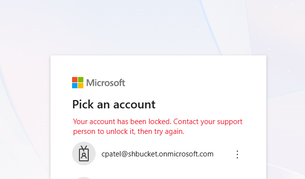
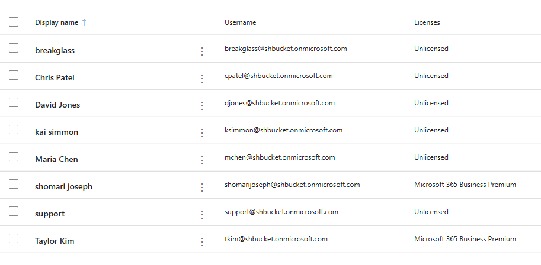
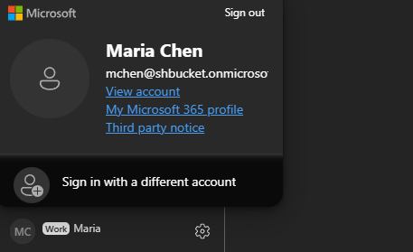
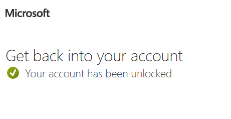

# Microsoft 365 Admin Lab

## Overview

The cloud half of my homelab. My [Active Directory lab](https://github.com/Shbucket/homelab-active-directory-labV2) runs an on-prem domain (`lab.internal`) inside a segmented [Cisco network](https://github.com/Shbucket/homelab-cisco-network-lab-rebuild-). This lab adds a **Microsoft 365 tenant** and works through the admin tasks a help desk handles every day: users and licenses, password resets, groups, shared mailboxes, least-privilege admin roles, MFA with Conditional Access, and offboarding.

It's built in stages:

| Stage | Topic | Status |
|---|---|---|
| 1 | Microsoft 365 administration | ✅ Done |
| 2 | Hybrid identity: Entra Connect sync of `lab.internal`, self-service password reset | ✅ Done |
| 3 | Intune: enroll WS01, compliance and configuration policies, app deployment | Planned |

Same method as the network and AD builds: **predict the result, make the change, verify it, and document what went wrong.**

## Environment

| Component | Details |
|---|---|
| Tenant | `shbucket.onmicrosoft.com` |
| Subscription | Microsoft 365 Business Premium (trial, 25 licenses), recurring billing turned off |
| Includes | Exchange Online, Teams, SharePoint, **Entra ID P1** (Conditional Access), **Intune** |

---

# Stage 1: Microsoft 365 administration

## 1. Lockout protection first

This tenant is a rebuild. I lost access to my first tenant (a Microsoft 365 developer sandbox) when the Authenticator app was my **only** sign-in method for the **only** admin account. There was no second way in, so the tenant had to be deleted. (Details under *Lessons Learned*.)

So before creating anything else in the new tenant:

| Protection | Why |
|---|---|
| Admin credentials saved in a password manager | Nothing depends on memory |
| Phone number registered as a second MFA method | Losing the Authenticator app no longer means losing the account |
| Authenticator cloud backup turned on | A new phone or reinstall restores the accounts |
| **Break-glass account** (`breakglass@`) — Global Administrator, no license, long password stored in the password manager, tested from a private window | A second way in if the main admin is ever locked out |

The break-glass account is the cloud version of the local `localadmin` account kept on WS01 in the AD lab. It doesn't need a license, since it only needs admin rights, not a mailbox.

---

## 2. Cloud-only users and licensing

| User | Department / title | License | Purpose |
|---|---|---|---|
| Taylor Kim (`tkim`) | Marketing, contractor | Business Premium | Standard user |
| Chris Patel (`cpatel`) | IT, Help Desk Technician | Business Premium | Help desk role, later offboarded |

These are deliberately **not** the AD lab users (jreyes, mchen, …). Those accounts will arrive through Entra Connect in stage 2. Creating cloud accounts with the same names first would make sync try to match them up, risking duplicate or merged accounts. Many real companies have a few cloud-only accounts like this, such as contractors.

Both were created with an auto-generated password and **"Require this user to change their password when they first sign in"**, the same principle as the AD lab: after first sign-in, IT doesn't know the user's password.

---

## 3. Password reset ticket

*Ticket: "Taylor Kim forgot her password and can't sign in."*

Active users → Taylor Kim → **Reset password**, auto-generated, with change-at-next-sign-in required. Signing in as tkim with the temporary password forced a new password, as expected.

Once Entra Connect is running, synced users' passwords live in on-prem AD, so their resets happen in ADUC, or in the cloud only with **password writeback** enabled (stage 2).

---

## 4. Groups

| Group | Type | Members | Owners | Used for |
|---|---|---|---|---|
| Marketing (`marketing@`) | Microsoft 365, private | tkim | tkim, admin | Shared inbox, calendar, SharePoint site and files for a team |
| All Staff (`allstaff@`) | Distribution list | tkim, cpatel | cpatel, admin | Company-wide email |
| Intune-Pilot | Security | tkim | admin | Targeting the first Intune policies (stage 3) |

- **Microsoft 365 group:** collaboration space — mailbox, calendar, files, optionally a Team.
- **Distribution list:** email only.
- **Security group:** permissions and policy targeting, no email — the equivalent of the AD lab's Finance-Staff.

**Ownership rules applied:**

- **Every group has at least two owners.** If the only owner leaves, the group is orphaned and only an admin can manage it.
- **Owners manage; members participate.** The admin account owns Marketing without receiving its mail.
- **Intune-Pilot is not role-assignable.** That option is only for groups that grant admin roles, it can't be changed after creation, and it restricts who can manage membership. This group only targets policy.

Verified: Marketing appeared under **Groups** in tkim's Outlook.

---

## 5. Shared mailbox

*Ticket: "Chris on the help desk needs to read and reply from support@ so customers see 'Support' instead of his name."*

Shared mailbox **Support** (`support@`):

| Permission | Granted to | Effect |
|---|---|---|
| Read and manage (Full Access) | cpatel | Open and work in the mailbox |
| Send as | cpatel | Replies appear from Support, not Chris |

**Result:** an email sent by cpatel from `support@` arrived in tkim's inbox with **Support** as the sender.





**Shared mailboxes need no license** (up to 50 GB) and **can't be signed into**: the account is created with sign-in blocked and no known password. Access comes only from permissions on real user accounts. When I opened Support by its direct URL, Outlook displayed "support" in the account menu, but clicking *View account* asked for Support's password — proof the session still belonged to cpatel.

---

## 6. Least-privilege admin role

*Ticket: "Chris needs to reset user passwords, but shouldn't have full admin access."*

Chris Patel → Manage roles → **Helpdesk Administrator**. Tested from a private window as cpatel:

| Action | Result |
|---|---|
| Reset tkim's password | ✅ Allowed |
| Open Billing / assign a license | ❌ Blocked (license counts visible, not editable) |
| Reset the **Global Admin's** password | ❌ Refused |

The last test is the important one: a Helpdesk Admin can't reset a more privileged admin's password, so a compromised help desk account can't be used to take over the tenant. Same idea as the separate `adm.` account in the AD lab.

---

## 7. MFA: Security defaults → Conditional Access

New tenants start with **Security defaults**: basic MFA that is all on or all off, with no exceptions. Business Premium includes Entra ID P1, so I replaced it with a **Conditional Access** policy, in an order that kept MFA on the whole time:

1. Created the policy in **Report-only** mode:

| Setting | Value |
|---|---|
| Name | CA01 - Require MFA - All users |
| Users | Include **All users**, exclude **breakglass** |
| Target resources | All resources |
| Grant | Require multifactor authentication |

2. Disabled Security defaults (reason: *My organization is using Conditional Access*).
3. Switched CA01 from Report-only to **On**.

| Test | Result |
|---|---|
| cpatel signs in | MFA required |
| breakglass signs in | Password only (excluded) |




**Why exclude break-glass:** if an MFA policy or the MFA service itself breaks, every admin covered by it is locked out. One excluded emergency account guarantees a way back in. In production it gets an offline-stored password and an alert on every sign-in.

---

## 8. Offboarding

*Ticket: "Chris Patel's last day was today. Remove his access and keep his email for his manager."*

| # | Action | Why |
|---|---|---|
| 1 | **Block sign-in** | Stops new sign-ins |
| 2 | **Sign out of all sessions** | Ends sessions already open — blocking alone doesn't (the same gap noted in the AD lab's offboarding) |
| 3 | Reset password to a random value | Nobody knows it if sign-in is re-enabled by mistake |
| 4 | Remove the Helpdesk Administrator role | Removes admin rights |
| 5 | Remove his Support mailbox permissions | Removes delegated access |
| 6 | **Convert his mailbox to shared**, give the manager Full Access | Keeps his email accessible |
| 7 | **Remove the license** — only after step 6 | Frees the license |
| 8 | Remove him from All Staff | The admin account remains owner — the reason every group has two |

**Order of 6 and 7 matters:** removing the license first starts the countdown to deleting the mailbox. Converting to shared first keeps the mail without a license.

**Result:** signing in as cpatel returned **"Your account has been locked."**



---

# Stage 2: Hybrid identity

```
 On-prem (lab.internal)                                Cloud (shbucket.onmicrosoft.com)
 DC01: AD DS + Entra Connect Sync  ── users, groups, password hashes ──►  Entra ID / Microsoft 365
                                   ◄── password writeback (resets, SSPR) ──
```

Goal: the department users from the AD lab sign in to Microsoft 365 with the **same password they use on WS01**, AD stays the source of truth, and password resets done in the cloud reach AD.

## 9. UPN suffix

Users signed in as `mchen@lab.internal`. A `.internal` domain can't be verified in Microsoft 365 — the cloud only accepts domains the tenant owns.

- **Active Directory Domains and Trusts → Properties:** added `shbucket.onmicrosoft.com` as an **alternative UPN suffix**.
- **ADUC:** changed the suffix for **ksimmon, mchen, djones**. abrooks (offboarded) and the `adm.` admin account were left alone.

On-prem sign-in (`LAB\mchen`) is unaffected. In production this would be the company's own verified domain; the onmicrosoft.com domain is the lab equivalent.



## 10. Entra Connect Sync

Installed on **DC01** with express settings, which enables **password hash sync**. (In production the sync server is a separate member server, treated with the same protection as a domain controller. Installing on DC01 is a lab simplification.) A Proxmox snapshot was taken first.

- Ran the installer as `LAB\Administrator`, since setup needs Enterprise Admin rights.
- **Unchecked "Start the synchronization process"** so nothing synced before filtering was set.

**OU filtering** (Configure → Customize synchronization options → Domain and OU filtering):

| Synced | OU | Reason |
|---|---|---|
| ✅ | LAB\Users (IT, HR, Finance, Sales) | The people |
| ✅ | LAB\Groups | Department groups usable in the cloud (SSPR targets HR-Staff) |
| ✅ | LAB\Computers\Workstations | WS01 must be synced for Intune hybrid join |
| ❌ | Disabled Users, Servers, Admin Accounts, Domain Controllers, built-in containers | Offboarded users, servers, admin accounts and system objects stay on-prem |

**Result:** ksimmon, mchen and djones appeared in Microsoft 365 as **Synced from on-premises**; abrooks and the admin account did not.

## 11. Synced users in Microsoft 365

- Licensed mchen with Business Premium. A synced user may need a **usage location** set before a license can be assigned.
- **mchen signed in to office.com with her WS01 password** — no cloud password was ever set. CA01 required her to register MFA.
- **AD is the source of authority.** The admin center blocked editing her synced attributes and, until writeback was enabled, resetting her password. Changes to synced users happen in ADUC and flow up.



## 12. Password writeback and self-service password reset

**Writeback** (Entra Connect → Optional features → Password writeback, and Entra admin center → Password reset → On-premises integration) lets password changes made in the cloud flow back down into AD.

*Ticket: "Maria Chen forgot her password."* Reset from the **Entra admin center** → a PasswordResetService event appeared on DC01 → the new password worked on **WS01** and in Microsoft 365.

**Self-service password reset (SSPR)**, piloted on the synced **HR-Staff** group:

| Setting | Value |
|---|---|
| Enabled for | Selected: HR-Staff |
| Methods required | 1 (Authenticator notification or code, mobile phone) |
| Registration at sign-in | Required |
| Writeback / unlock without reset | Yes / Yes |

| Test | Result |
|---|---|
| mchen resets a forgotten password at aka.ms/sspr | New password works on WS01 |
| mchen locked out on WS01 (5 bad attempts), unlocks at aka.ms/sspr without resetting | Signs in to WS01 with her current password; no IT involvement |

The second test is the cloud answer to the lockout ticket from the AD lab: the user unlocks herself instead of calling IT to click *Unlock account* in ADUC.



---

## Lessons Learned / Troubleshooting

**Locked out of the first tenant.** The developer sandbox's only admin account had the Authenticator app as its only MFA method. When the app could no longer approve sign-ins, there was no other way in: no second admin, no backup method, and no custom domain to prove ownership to Microsoft. Deleting the Developer Program profile to start over then triggered a 60-day wait before a new sandbox, so I moved to a Business Premium trial. Fix applied in the new tenant: two MFA methods, Authenticator backup, and a tested break-glass account before anything else (section 1).

**Group type not selectable.** The admin center has no type dropdown: the type is chosen by which tab is open (*Teams & Microsoft 365 groups*, *Distribution list*, *Security*) when clicking *Add*.

**Shared mailbox didn't appear for the user.** After Full Access was granted, Support didn't show in cpatel's Outlook. The direct URL (`outlook.office.com/mail/support@…`) opened it, proving the permission worked — auto-mapping simply takes up to an hour. Immediate fix for the user: **Add shared folder or mailbox** in Outlook on the web.

**"null" error on a password reset.** As Helpdesk Admin, resetting the Global Admin's password returned only "null". The admin center's error was unhelpful, but the result was correct: the reset was refused, and the admin password still worked.

**Password reset worked in Microsoft 365 but not on WS01.** After enabling writeback, I reset mchen's password in the **Microsoft 365 admin center**. Office accepted the new password; WS01 still accepted only the old one. DC01's Application log showed writeback was healthy (PasswordResetService connection events and regular 31019 heartbeats) but **no event for the reset** — AD never received it. Cause: [Microsoft 365 admin center resets don't use password writeback](https://learn.microsoft.com/es-es/troubleshoot/azure/entra/entra-id/user-prov-sync/password-writeback-microsoft-365-admin-center); only the cloud password changed, leaving the two out of sync. Resetting from the **Entra admin center** wrote back immediately. Real-world version: *"I reset her password, but she still can't log in to her PC."*

---

## What's Next

- **Intune:** enroll WS01, compliance policy, configuration profile and app deployment, piloted on the Intune-Pilot group
